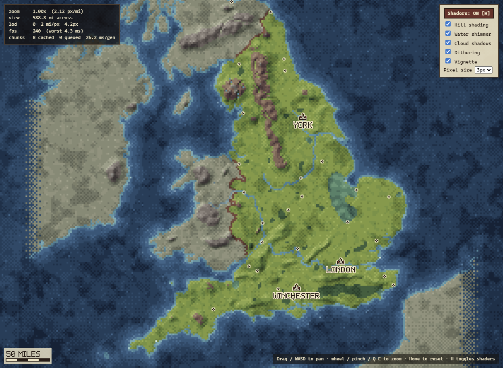

# England RPG Game: map demo

A zoomable, pannable pixel-art map of England, built as the foundation for a light-hearted medieval RPG.
It uses real Natural Earth geography, procedural terrain that adds detail as you zoom in, and WebGL shaders.



## Run it

```bash
npm install
npm run dev        # opens http://localhost:5173
```

It needs a browser with WebGL2 (any current Chrome, Edge, Firefox or Safari).

| Control | Action |
| --- | --- |
| Mouse wheel / trackpad pinch / touch pinch | Zoom toward the cursor |
| Click-drag / touch drag | Pan |
| WASD or arrow keys (Shift = faster) | Pan |
| Q / E | Zoom out / in |
| Home or 0 | Fit all of England |
| H | Toggle all shaders on/off |

The panel on the right toggles each effect and sets the pixel size. The panel on the top left shows zoom, miles across the
screen, LOD level, FPS, chunk-cache stats, and the lat/lon and realm under the cursor.

## Scale

One world unit is one statute mile. Everything is projected with a sinusoidal projection centred on 2°W
(`src/world/projection.ts`), which keeps distances within about 1% across England.

* **Minimum zoom** fits England's full bounding box (Scilly to Berwick, about 407 miles north to south).
* **Maximum zoom** shows 10 miles across the screen width.
* The scale bar (bottom left) updates with zoom.

The zoom *ratio* depends on your window's shape. On a 16:9 window, England fits by height, so the widest view spans
roughly 700 miles and max zoom is about 70×. In a square or portrait window it is about 35–40×. Both endpoints match
the spec; the ratio between them is whatever the aspect ratio makes it.

## How it works

```
src/
  world/          pure data + generation (no DOM/GL; runs in workers and Node)
    projection.ts   lat/lon <-> miles
    worldData.ts    loads baked grids; SDF sampling; river spatial index
    features.ts     real uplands, royal forests, fens, lakes (lat/lon footprints)
    terrain.ts      deterministic chunk generator (height, material, tone)
    noise.ts        seeded hash / gradient / band-limited fBm / worley noise
    settlements.ts  towns & cities
    riverCourses.ts hand-placed courses for rivers missing from Natural Earth
    lod.ts, materials.ts, seed.ts
  camera/         camera (zoom-to-cursor, clamping, smoothing) + input (wheel, drag, pinch, keys)
  render/         WebGL2 renderer, chunk cache, shaders, palette, 2D overlay (icons/labels/scale bar)
  workers/        chunk generation worker pool
  ui/             debug overlay, shader toggles
scripts/
  build-data.ts   Natural Earth -> public/data/*.bin (run once; output is committed)
  bench.ts, seams.ts, ascii.ts   generator speed/determinism/seam checks
```

**Level of detail.** LOD *k* has texels of 2^(1−k) miles, from 4 miles per texel at LOD −1 down to about 30 yards at LOD 7.
Each frame picks the LOD whose texels come out between 1× and 2× the chosen pixel size, so pixels always look chunky.
The world is cut into 128×128-texel chunks per LOD. Workers generate them in priority order (nearest the screen
centre first) and they're cached as GPU textures with LRU eviction. While a chunk is still generating, the nearest
coarser ancestor is drawn scaled up in its place.

**Deterministic and seamless.** Every texel is a pure function of `(WORLD_SEED, world position, LOD)`, so chunks line up
exactly and the same seed always gives the same map (`npx tsx scripts/seams.ts` checks this). Noise is band-limited
per LOD: detail finer than about 2 texels fades out, so coarse levels stay clean. Detail that only exists when
zoomed in is gated by LOD:

| LOD | Shows |
| --- | --- |
| all levels | coastline, major rivers, hill shading, forests, moors |
| ≥ 1 / ≥ 2 | secondary / minor rivers, beaches |
| ≥ 3 | open-field blocks, fen meres |
| ≥ 4 | streams, field boundaries |
| ≥ 5 | hedged parcels, country lanes, scattered trees with shadows |
| ≥ 6 | individual tree crowns, strip-farming furrows |

**Rendering pipeline** (`src/render/renderer.ts`):
1. **Data pass.** Chunk textures (height, material and tone packed into RGBA8) are drawn into a low-res buffer where
   1 texel = 1 art pixel, aligned to the world grid.
2. **Colour pass.** For each art pixel: hill-shading from the height neighbours, animated water shimmer and
   sparkles, drifting cloud shadows, and a vignette. Each effect is applied as an *offset along the material's
   8-tone palette ramp*, then quantised with world-anchored 4×4 Bayer dithering. The output therefore always stays
   inside the limited palette, and the dither pattern doesn't crawl when you pan.
3. **Present.** A "sharp-bilinear" upscale to the screen, offset by the camera's sub-texel position. This gives
   uniformly sized hard pixels, smooth sub-pixel panning, and no jitter while zooming.

## Data sources

* **Coastline and borders:** [Natural Earth](https://www.naturalearthdata.com/) 1:10m *Admin 0 – Map Units*
  (public domain), which splits the UK into England, Wales, Scotland and Northern Ireland. Ireland, the Isle of Man,
  France, Belgium and the Netherlands are drawn greyed as neighbouring realms.
  `scripts/build-data.ts` rasterises these into 0.5-mile signed-distance fields for land/sea and for England's
  boundary, so coastlines stay smooth at every zoom level.
* **Rivers:** Natural Earth 1:10m *Rivers + Lake Centerlines* and the *Rivers Europe* supplement (public domain),
  which provide the Thames, Severn, Trent, Great Ouse, Wye, Swale and Tweed.

`npm run build-data` downloads the raw GeoJSON into `raw/` (git-ignored) and rebuilds `public/data/`. The baked
output is committed, so you don't need to run it for `npm run dev`.

## What is approximated

* **Coastline detail below about 1 km** is procedural (seeded fBm added to the distance field). Natural Earth 1:10m
  is roughly kilometre-accurate, so at 10-mile zoom the exact wiggles are invented. The shape is not.
* **Rivers not in Natural Earth** are hand-placed waypoint polylines through the real towns and bridges on each
  course (`src/world/riverCourses.ts`): Yorkshire Ouse, Humber, Ure, Aire, Derwent ×2, Don, Tyne ×3, Wear, Tees, Eden,
  Lune, Ribble, Mersey, Dee, the three Avons, Stour, Test, Itchen, Exe, Tamar, Dart, Parrett, Nene, Welland, Witham,
  Medway, Yare, Great Stour, Cam, Soar, Kennet, Cherwell, Lea, Gipping/Orwell and Hull. Meanders between waypoints
  are procedural. Small streams are entirely procedural.
* **Terrain height** is not a real DEM. It's noise shaped by hand-placed footprints of the real uplands (Lake
  District, Pennines, Peak, Cheviots, North York Moors, Wolds, Cotswolds, Chilterns, Downs, Mendips, Exmoor,
  Dartmoor, Bodmin, Shropshire Hills, Malverns, plus Welsh and Scottish ranges), with valleys carved along rivers.
* **Land cover** follows medieval geography: royal forests (New Forest, Sherwood, Dean, Arden, the Weald, Epping and
  others), the undrained Fens with Whittlesey Mere, the Somerset Levels, Romney Marsh and the Broads. Fields, hedges,
  lanes and trees are procedural.
* **Lakes** (Windermere, Ullswater, Derwentwater and others) are hand-placed capsules with noisy shores.
* **Settlements** use modern lat/lon for the medieval core, which is within a mile or so.
* The **England/Wales/Scotland boundaries** are the modern ones. Note that Berwick was Scottish in 1215, and it's
  flagged `foreign` in the settlement list.

## Adding a town

Add an entry to `SETTLEMENTS` in `src/world/settlements.ts`:

```ts
{ name: 'Ludlow', lon: -2.716, lat: 52.367, tier: 3, kind: 'castle' },
```

* `tier`: 1 = always labelled, 2 = labelled below about 420 miles across, 3 = labelled below about 180 miles across (icon shown sooner).
* `kind`: `'city' | 'town' | 'port' | 'castle'` picks the icon sprite (sprites are ASCII art in `src/render/overlay.ts`).
* `foreign: true` draws it muted (outside the English crown's lands).

Save and Vite hot-reloads. No data rebuild is needed.

## Changing the world

* **Seed:** `WORLD_SEED` in `src/world/seed.ts`.
* **Uplands, forests, fens, lakes:** `src/world/features.ts` (lat/lon + miles, no rebuild needed).
* **Palette:** `src/render/palette.ts` (8-tone ramp per material; greyed neighbour realms are derived automatically).
* **Map extent / projection:** `src/world/projection.ts`, then `npm run build-data`.

## Hooks for later

`WorldData` (distance fields, region lookup, river index) and `TerrainGenerator` are DOM-free, so game logic can
reuse them. They can answer "is this land?", "which realm?", "how far to a river?" and "what's the terrain here?",
which is what route-finding for parties, travel speed and event placement will need. The `Path` material and the
district-boundary lanes are a placeholder for a real road network.
